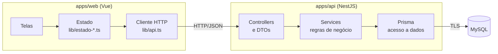

<div align="center">

# SGP Católica

### Da criação da prova à devolutiva da nota, em um único fluxo.

O professor prepara e aplica avaliações, corrige cartões-resposta pelo celular e
acompanha resultados. O estudante consulta suas notas com mais rapidez e clareza.

[](#fase-atual)
[](#fase-atual)
[](apps/web)
[](package.json)
[](apps/mobile)
[](apps/mobile)
[](.nvmrc)
[](apps/api)
[](docs/modelo-dados/der.md)


**[Sistema hospedado](https://sgp-catolica.onrender.com)** ·
[Visão do produto](docs/produto/visao-do-produto.md) ·
[Documentação](docs/README.md) ·
[Executar localmente](#executar-localmente) ·
[Contribuir](CONTRIBUTING.md)

</div>

---

## Avaliar não precisa significar corrigir tudo à mão

Em semanas de prova, um professor pode acumular centenas de avaliações para
corrigir. O SGP Católica nasce para reduzir esse trabalho: organiza turmas e
questões, gera provas com versões diferentes, identifica cada aplicação por QR Code
e transforma a correção em uma experiência rápida pelo celular.

Para o estudante, o mesmo fluxo encurta a espera pela nota e reúne o histórico de
desempenho em um único lugar.

## Uma experiência, três perspectivas

| Professor na web                                | Professor no aplicativo                                | Estudante na web                              |
| :---------------------------------------------- | :----------------------------------------------------- | :-------------------------------------------- |
| Organiza turmas, questões, provas e aplicações. | Lê o QR Code, confere respostas e registra a correção. | Entra em turmas e acompanha notas e evolução. |

O fluxo central conecta as três superfícies:

**criar a prova → gerar as versões → aplicar → corrigir → publicar o resultado**

## Fase atual

> **N2 — integração real com banco de dados.** A web passou a ler e gravar num MySQL
> real por meio de uma API própria. Turmas, matrículas, banco de questões e provas
> funcionam de ponta a ponta, do navegador ao banco.

| Sistema             | Endereço                                                         |
| ------------------- | ---------------------------------------------------------------- |
| Aplicação web       | [sgp-catolica.onrender.com](https://sgp-catolica.onrender.com)   |
| API (saúde e banco) | [sgp-api.onrender.com/saude](https://sgp-api.onrender.com/saude) |

A API roda numa instância gratuita que hiberna sem uso: o primeiro acesso depois de um
tempo parado leva cerca de um minuto para carregar.

### Estado da integração com o banco

| Tela                                     | Dados                                           |
| ---------------------------------------- | ----------------------------------------------- |
| Turmas e detalhe da turma (RF03)         | MySQL: criar, editar, arquivar, convite, alunos |
| Banco de questões (RF02)                 | MySQL: criar, editar, excluir e restaurar       |
| Provas e editor de prova (RF04)          | MySQL: criar, editar título, questões e blocos  |
| Aplicações, correções, relatórios, aluno | Ainda em dados de demonstração (próxima etapa)  |

O banco começa com os dados de demonstração de [`packages/mocks`](packages/mocks),
carregados pelo seed, para a apresentação ter conteúdo desde o primeiro acesso. O
modelo completo já existe no banco, inclusive as tabelas das próximas telas; o que
falta para elas são os endpoints. Divergências e definições em aberto continuam em
[`docs/pendencias.md`](docs/pendencias.md).

## Produto e requisitos

A especificação do produto está organizada fora deste README para que esta página
continue simples e orientada à visão geral:

- [Visão do produto](docs/produto/visao-do-produto.md) — problema, público e proposta de valor.
- [Requisitos funcionais](docs/produto/requisitos-funcionais.md) — RF01 a RF11 e critérios de aceite.
- [Requisitos não funcionais](docs/produto/requisitos-nao-funcionais.md) — desempenho, segurança, privacidade, operação offline e qualidade.
- [Dicionário de entidades](docs/modelo-dados/dicionario-de-entidades.md) — conceitos do domínio e correspondência com os tipos do código.
- [Diagramas UML](docs/uml/README.md) — casos de uso, atividade, classes e sequência, com o passo a passo de cada um.
- [Modelo de dados (DER)](docs/modelo-dados/der.md) — tabelas, chaves e cardinalidades do MySQL, com as decisões de modelagem.

O recorte de requisitos por entrega ainda não foi aprovado. A especificação descreve
o produto completo; ela não deve ser confundida com o escopo técnico de cada fase.

## Arquitetura

O projeto é um monorepo TypeScript com **Vue e Vite** na experiência web,
**React Native e Expo** no aplicativo do professor, uma **API em NestJS** e pacotes
compartilhados para tipos, dados de demonstração e identidade visual.

```text
apps/       web · mobile · api
packages/   shared-types · mocks · design-tokens
docs/       produto · design · uml · modelo de dados · api · decisões
```

A aplicação é organizada em camadas, cada uma falando só com a vizinha:



- **Telas** não sabem de onde vêm os dados: leem e alteram o estado.
- **Estado** (`lib/estado-*.ts`) é o único ponto que fala com a API. Sem `VITE_API_URL`,
  usa os dados de demonstração, o que mantém o modo offline da N1 para desenvolvimento.
- **Controllers** validam a entrada (DTOs com `class-validator`); **services** aplicam as
  regras dos requisitos (por exemplo, 2 a 5 alternativas na questão objetiva, até 20
  questões por prova); o **Prisma** faz o acesso ao MySQL.
- Os tipos de `@sgp/shared-types` são o contrato entre as duas pontas: a API devolve
  exatamente o formato que as telas consomem.

A stack da API (NestJS sobre Express, MySQL e Prisma) é a proposta da
[issue #66](https://github.com/Catolica-Tech-Academy-Hub/sgp-catolica/issues/66) para a
divergência entre Node.js com Express e NestJS/Fastify; ela vira decisão formal em
`docs/decisoes/` com o acordo da equipe. Endpoints, execução e hospedagem estão em
[`docs/api/`](docs/api/README.md).

## Executar localmente

Versões usadas: **Node.js 20 ou superior** (22 na hospedagem), **npm 10 ou superior**,
**MySQL 8.4** (via Docker) e **Docker** com Compose para o banco local.

```bash
git clone https://github.com/Catolica-Tech-Academy-Hub/sgp-catolica.git
cd sgp-catolica
npm ci
```

```bash
npm run web        # aplicação web em http://localhost:5173
npm run mobile     # aplicativo do professor com Expo
npm run api        # API em http://localhost:3000 (requer o MySQL, ver docs/api)
npm run typecheck  # valida todos os workspaces
npm run lint       # ESLint em web, mobile e api
npm run format     # aplica a formatação do Prettier
```

Para usar a web com o banco local:

```bash
docker compose up -d                            # MySQL 8.4 em localhost:3306
cp apps/api/.env.example apps/api/.env
npm run db:deploy --workspace @sgp/api          # cria as tabelas
npm run db:seed --workspace @sgp/api            # carrega os dados de demonstração
npm run api                                     # API em http://localhost:3000
cp apps/web/.env.example apps/web/.env.local    # VITE_API_URL=http://localhost:3000
npm run web
```

A publicação (MySQL no Aiven, API e web no Render) está descrita em
[`docs/api/README.md`](docs/api/README.md#produção).

## Documentação

[`docs/README.md`](docs/README.md) é a porta de entrada para a documentação completa.
Lá estão os requisitos, o modelo do domínio, as pendências e, conforme o projeto
evoluir, os diagramas, decisões arquiteturais, telas, API e manual do usuário.

Para participar do desenvolvimento, consulte o
[`CONTRIBUTING.md`](CONTRIBUTING.md). O guia reúne o fluxo de Issues, branches,
commits, Pull Requests e revisão da equipe.

## Equipe

<table align="center">
  <tr>
    <td align="center" width="160">
      <br>
      <sub><strong>Cintia Wilbert<br>Lorenzetti</strong></sub>
    </td>
    <td align="center" width="160">
      <br>
      <sub><strong>Gabriel Massaia<br>de Oliveira</strong></sub>
    </td>
    <td align="center" width="160">
      <br>
      <sub><strong>Leonardo Matheus<br>Anders</strong></sub>
    </td>
    <td align="center" width="160">
      <br>
      <sub><strong>Rian Carlos<br>Odwazny Flexa</strong></sub>
    </td>
    <td align="center" width="160">
      <br>
      <sub><strong>Wesley Diorrani<br>Ferreira</strong></sub>
    </td>
  </tr>
</table>

<div align="center">

Projeto acadêmico da disciplina de Projeto e Arquitetura de Software.

</div>
