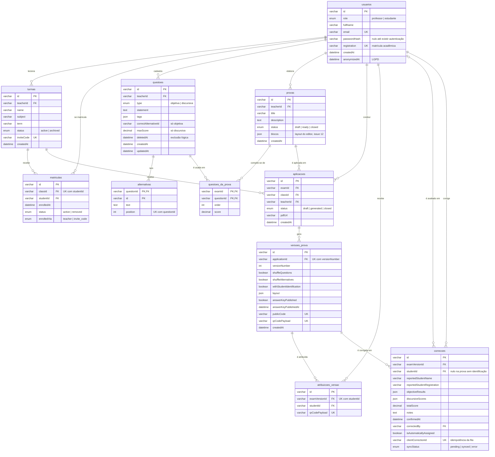

# Modelo de dados (DER)

Diagrama entidade-relacionamento do banco MySQL do SGP Católica, na N2. Ele é derivado
do modelo físico em [`apps/api/prisma/schema.prisma`](../../apps/api/prisma/schema.prisma)
e acompanha o [dicionário de entidades](dicionario-de-entidades.md), que explica o
significado de cada conceito. Os nomes das tabelas são os do banco; os dos campos são os
mesmos de `@sgp/shared-types`, para a API devolver o formato que as telas já consomem.

## Diagrama

Notação de pé de galinha do Mermaid: `||` é exatamente um, `o|` é zero ou um, `o{` é
zero ou muitos. PK é chave primária, FK é chave estrangeira e UK é chave única.

## Decisões de modelagem

- **Uma tabela de usuários para os dois papéis.** Professor e estudante diferem pelo
  campo `role`, como no dicionário. Por isso várias relações saem de `usuarios`: a turma
  e a prova apontam para o professor, a matrícula e a correção apontam para o estudante.
- **Questões da prova como tabela associativa.** A relação entre prova e questão é de
  muitos para muitos e carrega dados próprios (ordem na folha e pontuação), então vira
  `questoes_da_prova`, com chave composta. Uma questão aparece no máximo uma vez por prova.
- **Alternativas em tabela própria.** Ficam ordenadas por `position`, com chave composta
  por questão e alternativa. Excluir a questão apaga as alternativas em cascata.
- **Exclusão lógica onde o histórico importa.** A questão excluída ganha `deletedAt` e
  continua existindo, porque provas antigas a usam. A turma é arquivada (`status`) e a
  matrícula é removida (`status`), sem apagar notas.
- **Colunas JSON para o que é lido e gravado inteiro.** Etiquetas da questão, layout da
  versão, resultados objetivos, notas discursivas e os blocos do editor de prova nunca
  são consultados por partes, então não viram tabelas.
- **Correção anônima.** `correcoes.studentId` é opcional: na prova sem identificação,
  nada liga a correção a um estudante (RF09), e o nome informado fica só como dado
  auxiliar.
- **Idempotência da sincronização.** `clientCorrectionId` é único: o aplicativo reenvia
  a mesma correção da fila sem duplicá-la (RF08).

## Estado da integração (N2)

| Tabela                                                           | Lida e gravada pela aplicação                      |
| ---------------------------------------------------------------- | -------------------------------------------------- |
| `turmas`, `matriculas`, `usuarios` (estudantes)                  | Sim, pelas telas de turmas (API `/turmas`)         |
| `questoes`, `alternativas`                                       | Sim, pelo banco de questões e pelo editor          |
| `provas`, `questoes_da_prova`                                    | Sim, pela lista de provas e pelo editor            |
| `aplicacoes`, `versoes_prova`, `atribuicoes_versao`, `correcoes` | Criadas e populadas pelo seed; ainda sem endpoints |
